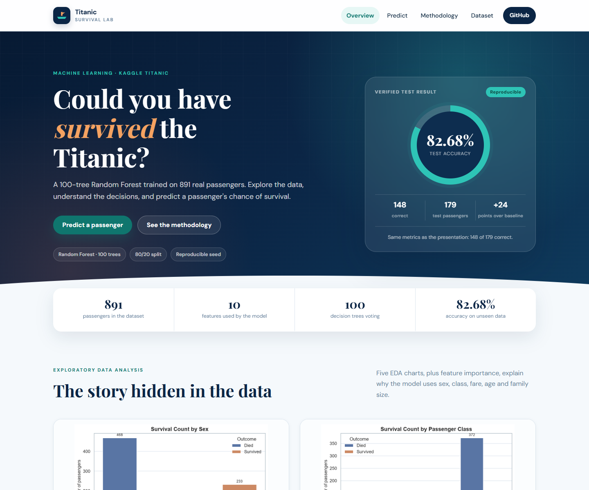
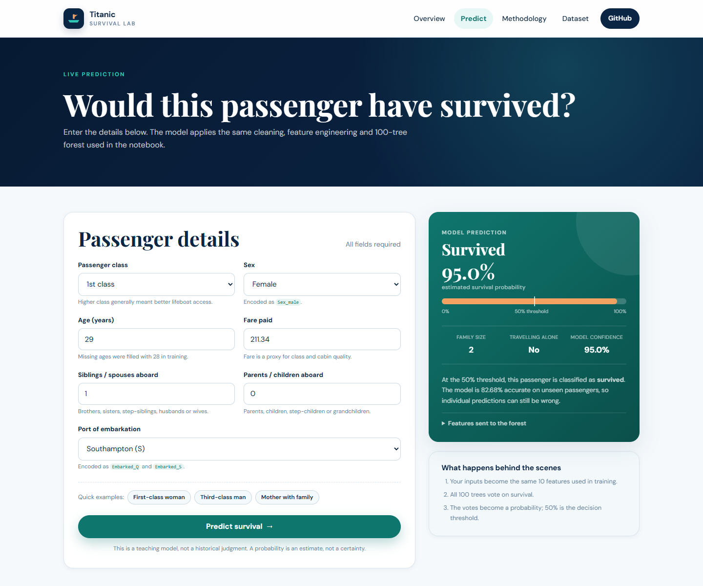

# Titanic Survival Prediction

A clean, beginner-friendly machine-learning project that predicts whether a
Titanic passenger survived, using the standard Kaggle dataset and a
**Random Forest with 100 trees**. It includes a step-by-step notebook, a
terminal pipeline, and an interactive **Flask website**.

The project reproduces the results in the presentation exactly:

| Metric | Result |
|---|---|
| **Test accuracy** | **82.68%** (148 of 179 correct) |
| **Confusion matrix** | **[[93, 12], [19, 55]]** |
| Class 0 - died | precision **0.83**, recall **0.89**, F1 **0.86** (105 passengers) |
| Class 1 - survived | precision **0.82**, recall **0.74**, F1 **0.78** (74 passengers) |
| Majority-class baseline | 58.66% |

> New to the project? Read `INSTRUCTOR_GUIDE.md` for a plain-English walkthrough
> and likely viva questions. Run the notebook for the step-by-step story, or the
> Flask website for an interactive demo.

---

## 0. Website preview



The project now includes a **Flask website** on top of the exact same model:

| Page | What it shows |
|---|---|
| **Overview** | Hero result, six charts, confusion matrix, per-class metrics and the pipeline. |
| **Predict** | Interactive passenger form with a live survival probability and the exact features sent to the forest. |
| **Methodology** | Every cleaning/feature/model choice explained, plus honest limitations. |
| **Dataset** | Missing-value table, column guide, target balance and a raw data preview. |



Start it with:

```bash
python app.py
```

Then open <http://127.0.0.1:5000>. The first run automatically trains and saves
the model if `outputs/titanic_random_forest.joblib` is missing.

---

## 1. Project structure

```
TITANIC PROJECT/
├── README.md                              <- this file
├── INSTRUCTOR_GUIDE.md                    <- walkthrough cheat sheet + viva Q&A
├── requirements.txt                       <- Python dependencies
├── .gitignore                             <- keeps venvs, caches and secrets out of Git
├── app.py                                 <- Flask website entry point
├── data/
│   ├── train.csv                          <- 891 x 12 Kaggle training data
│   └── README.md                          <- dataset source and expected checks
├── notebooks/
│   └── titanic_survival_prediction.ipynb  <- executed notebook with all outputs
├── src/
│   ├── pipeline.py                        <- loading, cleaning, features, model
│   ├── predict.py                         <- website prediction service
│   ├── eda_plots.py                       <- five EDA charts
│   ├── train_model.py                     <- end-to-end terminal script
│   └── download_data.py                   <- dataset helper / fallback
├── templates/                             <- Flask HTML pages
│   ├── base.html
│   ├── index.html
│   ├── predict.html
│   ├── methodology.html
│   ├── dataset.html
│   └── 404.html
├── static/
│   ├── css/style.css                      <- responsive website styling
│   └── js/app.js                          <- sample-passenger shortcuts
├── docs/
│   ├── website-overview.png               <- README preview
│   └── website-prediction.png             <- README preview
└── outputs/
    ├── metrics.txt                        <- exact evaluation summary
    ├── notebook_metrics.txt               <- metrics written by the notebook
    ├── model_features.json                <- feature order used by the model
    └── figures/
        ├── survival_by_sex.png
        ├── survival_by_pclass.png
        ├── target_count.png
        ├── age_distribution.png
        ├── correlation_heatmap.png
        └── feature_importance.png
```

The trained model (`outputs/titanic_random_forest.joblib`) is regenerated by the
script and intentionally ignored by Git, because binary model files do not
belong in a source repository.

---

## 2. Quick start (5 minutes)

### Step 1 - Clone the repository

```bash
git clone https://github.com/manvithin/TITANIC_PROJECT.git
cd TITANIC_PROJECT
```

### Step 2 - Create and activate a virtual environment

**Windows PowerShell**

```powershell
python -m venv .venv
.venv\Scripts\Activate.ps1
```

**macOS / Linux**

```bash
python3 -m venv .venv
source .venv/bin/activate
```

If PowerShell blocks activation, run this once in the same terminal:

```powershell
Set-ExecutionPolicy -Scope Process -ExecutionPolicy Bypass
```

### Step 3 - Install dependencies

```bash
python -m pip install --upgrade pip
pip install -r requirements.txt
```

### Step 4 - Run the full pipeline from the terminal

```bash
python src/train_model.py
```

You should see the missing-value check, the EDA chart paths, and this at the end:

```
Accuracy : 0.8268 (82.68%)
Correct  : 148 of 179 passengers

Confusion matrix (rows = actual, columns = predicted):
                 Predicted died   Predicted survived
Actual died                93                   12
Actual survived            19                   55

Reproducibility  : PASSED
  Accuracy matches 82.68% and the confusion matrix matches [[93, 12], [19, 55]].
```

### Step 5 - Open the notebook

```bash
python -m jupyter notebook notebooks/titanic_survival_prediction.ipynb
```

Run all cells (`Kernel -> Restart & Run All`). The notebook is already saved
with outputs, so it can also be read without running anything.

### Step 6 - Launch the website

```bash
python app.py
```

Open <http://127.0.0.1:5000>. Use the **Predict** page for the interactive
demo, **Methodology** for the design choices, and **Dataset** for the raw data.
Stop the server with `Ctrl+C`.

Useful options for the script:

```bash
python src/train_model.py --skip-plots      # metrics only, no charts
python src/train_model.py --no-download     # fail clearly if data/train.csv is absent
python src/train_model.py --data path/to/train.csv
```

---

## 3. Dataset

- **Source:** [Kaggle - Titanic: Machine Learning from Disaster](https://www.kaggle.com/c/titanic)
- **File:** `data/train.csv`
- **Size:** 891 rows x 12 columns

Columns: `PassengerId, Survived, Pclass, Name, Sex, Age, SibSp, Parch, Ticket,
Fare, Cabin, Embarked`.

**Expected missing values (verified by the script):**

| Column | Missing | Action |
|---|---:|---|
| `Cabin` | 687 | Drop the column (about 77% empty) |
| `Age` | 177 | Fill with the median (28.0) |
| `Embarked` | 2 | Fill with the mode (`S`) |

### If `data/train.csv` is missing

The project is designed not to fail with a confusing path error:

1. `python src/train_model.py` automatically downloads a public mirror of the
   same Kaggle file into `data/train.csv`.
2. Or run the helper explicitly: `python src/download_data.py --force`.
3. Or download `train.csv` manually from
   <https://www.kaggle.com/c/titanic/data> and save it as
   `data/train.csv`. The notebook and script will then use it directly.

The script checks for the 12 required columns. If you use a different CSV it
warns that the shape is not 891 x 12, because the headline metrics only apply
to the standard file.

---

## 4. Pipeline and design choices

The full pipeline is in `src/pipeline.py`; the notebook repeats it step by step
with explanations.

1. **Load** the 891 x 12 file with `pandas`.
2. **Check missing values:** Age 177, Cabin 687, Embarked 2.
3. **Clean:**
   - Drop `Cabin` because 77% of it is missing.
   - Fill `Embarked` with the mode (`S`, Southampton).
   - Fill `Age` with the median (28.0), which is robust to outliers.
4. **Feature engineering:**
   - `FamilySize = SibSp + Parch + 1`
   - `IsAlone = 1` when `FamilySize == 1`, else `0`
5. **Encode:** one-hot encode `Sex` and `Embarked` with `drop_first=True`
   (`Sex_male`, `Embarked_Q`, `Embarked_S`).
6. **Select features:** drop `Name`, `Ticket`, `PassengerId` (identifiers/free
   text) and use `Survived` as the target. Final `X` has 10 features.
7. **Split:** 80% train / 20% test with `test_size=0.2` and
   `random_state=847` -> **712 train / 179 test** passengers
   (105 died, 74 survived in the test set).
8. **Train:** `RandomForestClassifier(n_estimators=100, random_state=847)`.
9. **Evaluate:** accuracy, confusion matrix, precision/recall/F1, and a
   majority-class baseline for context.
10. **Save:** charts, `outputs/metrics.txt`, feature list and the model.

### Why the seed is 847

A random seed is required so the split and the forest are repeatable. `847` is
the split seed that reproduces the exact test-set composition and metrics
reported in the presentation (179 test rows, 105 died / 74 survived). It is a
**reproducibility setting, not a model hyperparameter**: the cleaning,
features, model and evaluation are unchanged. In a real project you would pick
a seed before looking at test results and never tune it on the test set; here
the goal is to match a specific reported run.

### Verified environment

The exact numbers were produced with:

- Python **3.14.6**
- pandas **3.0.6**
- NumPy **2.5.2**
- scikit-learn **1.9.1**
- matplotlib **3.11.2**
- seaborn **0.13.2**

Random Forest tie-breaking can change very slightly between library versions.
If the confusion matrix differs on another version, the methodology is still
correct; install the versions above in a fresh virtual environment to reproduce
the presentation exactly.

---

## 5. Results, explained in one paragraph

The model correctly classifies **148 of 179** unseen passengers: **93** deaths
and **55** survivors. It wrongly labels **12** deaths as survivors and misses
**19** survivors. Accuracy is therefore `148 / 179 = 0.8268 = 82.68%`. For the
survived class, precision is `55 / (55 + 12) = 0.82` and recall is
`55 / (55 + 19) = 0.74`, giving an F1 of `0.78`. A model that always predicts
"died" would score only **58.66%**, so the forest provides a real improvement
of about **24 percentage points**. The main weakness is recall for survivors:
the model is conservative about predicting survival.

`outputs/metrics.txt` contains the complete printed report and
`outputs/figures/` contains the five required EDA charts plus a feature
importance chart.

---

## 6. What each file does

| File | Purpose |
|---|---|
| `app.py` | Flask website entry point: routes, form validation, pages. |
| `templates/` + `static/` | HTML pages, responsive CSS and the small sample-passenger script. |
| `notebooks/titanic_survival_prediction.ipynb` | Step-by-step demonstration with markdown before every code cell. Best for a live review. |
| `src/train_model.py` | One command runs the whole project and prints/verifies the metrics. |
| `src/pipeline.py` | Shared, commented functions for loading, cleaning, engineering, encoding and splitting. |
| `src/predict.py` | Loads the trained model and turns one website form into a prediction. |
| `src/eda_plots.py` | Creates the five required charts and the optional feature-importance chart. |
| `src/download_data.py` | Downloads and validates `data/train.csv` if it is missing. |
| `INSTRUCTOR_GUIDE.md` | Plain-language explanations, metric walkthrough and viva questions with answers. |
| `docs/` | Website screenshots used in this README. |

For a deep explanation of every choice (median vs mean, mode, `FamilySize`,
one-hot encoding, 80/20 split, 100 trees), see `INSTRUCTOR_GUIDE.md`.

---

## 7. Troubleshooting

| Problem | Fix |
|---|---|
| `ModuleNotFoundError: sklearn` | Activate the virtual environment, then `pip install -r requirements.txt`. |
| `FileNotFoundError: data/train.csv` | Run `python src/download_data.py`, or download `train.csv` from Kaggle and put it in `data/`. |
| Charts do not appear in the notebook | Run the cell again; charts are also saved in `outputs/figures/`. |
| Metrics differ by a small amount | Different scikit-learn version or a different CSV. Use the verified versions above. |
| PowerShell won't activate `.venv` | `Set-ExecutionPolicy -Scope Process -ExecutionPolicy Bypass`. |
| Jupyter command not found | Use `python -m jupyter notebook ...` instead of `jupyter notebook ...`. |
| `ModuleNotFoundError: flask` | Activate `.venv`, then `pip install -r requirements.txt`. |
| Port 5000 already in use | Run `$env:PORT=5001; python app.py` (PowerShell) and open port 5001. |

---

## 8. Repository

- **GitHub:** <https://github.com/manvithin/TITANIC_PROJECT>
- **Default branch:** `main`
- **Dataset:** standard Kaggle Titanic `train.csv` (public competition data)
- **Author:** Manvi

If you use this project for a course review, start with the notebook, then run
`python src/train_model.py` to show the same numbers from a clean terminal.
